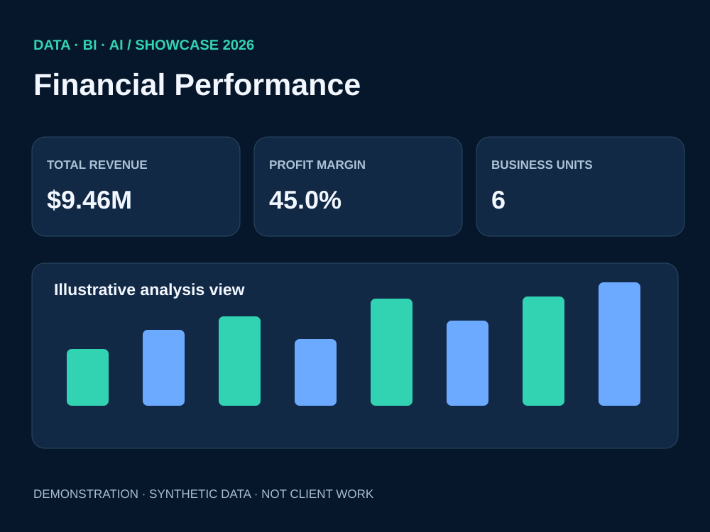
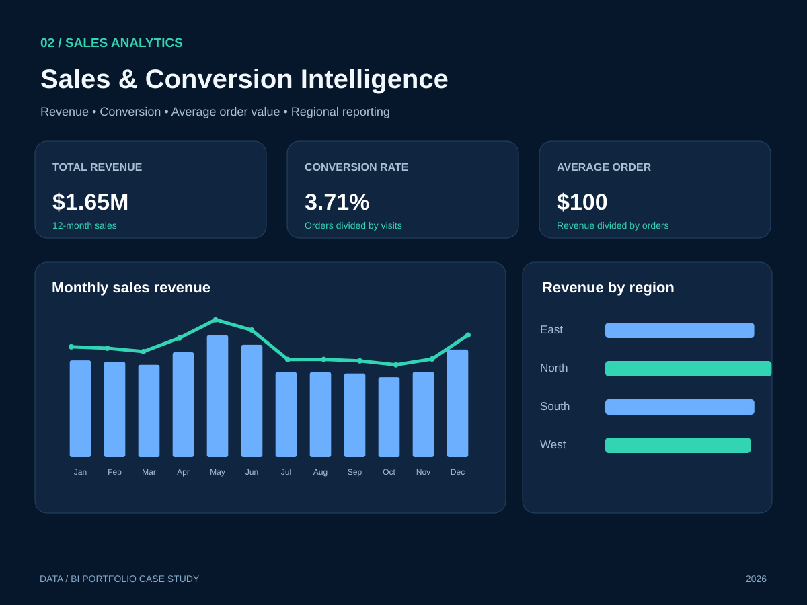
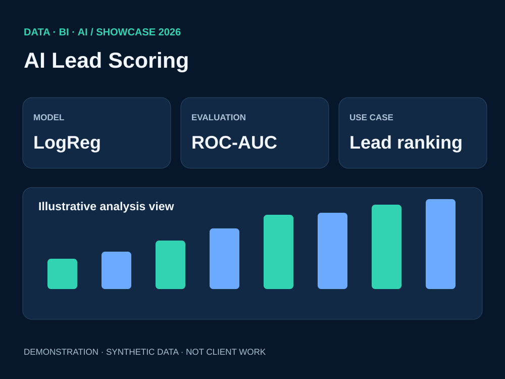
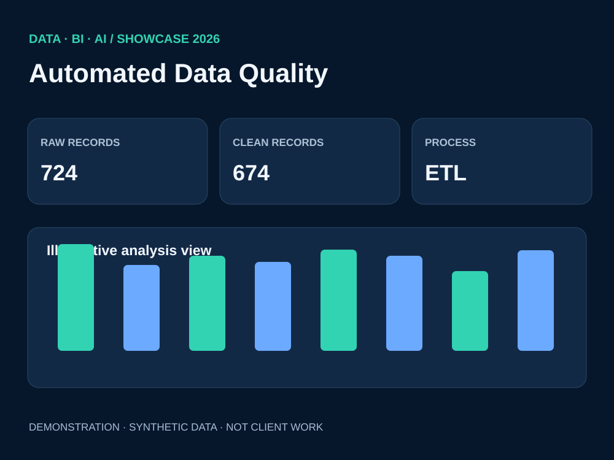

# Data, BI & AI — Upwork Portfolio Showcase (2026)

Four **demonstration case studies using synthetic data**, built to illustrate practical delivery in business intelligence, analytics, machine learning and data automation.

> **Transparency:** These are self-directed demonstrations, not paid client work. Illustrations are *not* screenshots from Power BI Desktop. No confidential datasets or invented client ROI are used.

| Case | Preview | What it demonstrates | Evidence |
|---|---|---|---|
| [01 — Financial Performance](finance/README.md) |  | Revenue, margin, cost-to-income, KPI design and DAX | [DAX](finance/measures.dax) |
| [02 — Sales & Conversion](sales/README.md) |  | Revenue, AOV, conversion and channel comparisons | [DAX](sales/measures.dax) |
| [03 — AI Lead Scoring](ai/README.md) |  | Scikit-learn classification and holdout validation | [Demo Python](src/ai_demo.py) |
| [04 — Data Quality & ETL](etl/README.md) |  | Deduplication, validation and SQLite reporting | [Demo Python](src/etl_demo.py) |

## Existing projects in this GitHub account

- **Actual Power BI file:** [Clothing Store Power BI dashboard (.pbix)](https://github.com/Othmane-data/Clothing-Store_Dashboard_by_POWER_BI)
- **Extensive real project documentation:** [Lead conversion machine learning on Databricks](https://github.com/Othmane-data/lead-conversion-ml-databricks/tree/main)
- **Big Data demonstration:** [Telco churn on PySpark/Databricks](https://github.com/Othmane-data/telco-churn-pyspark-databricks)

## Reproduce the Python examples

~~~bash
pip install -r requirements.txt
python src/ai_demo.py
python src/etl_demo.py
~~~

Both examples create synthetic records with fixed seeds, print quality/model metrics and require no customer data. For a more elaborate bundle of PNG dashboard previews, CSV data, DAX and scripts, use the ZIP package generated in the ChatGPT conversation. This branch houses the GitHub-readable case studies and reproducible code examples.

## Upwork-ready copy

See [portfolio entries](upwork/PORTFOLIO_ITEMS.md) and [Project Catalog packages](upwork/PROJECT_CATALOG.md). Titles, descriptions and tags are tailored for an English-speaking audience.

**Privacy & professional integrity:** No client names, logos, confidential exports or unsubstantiated real-world performance improvements.
