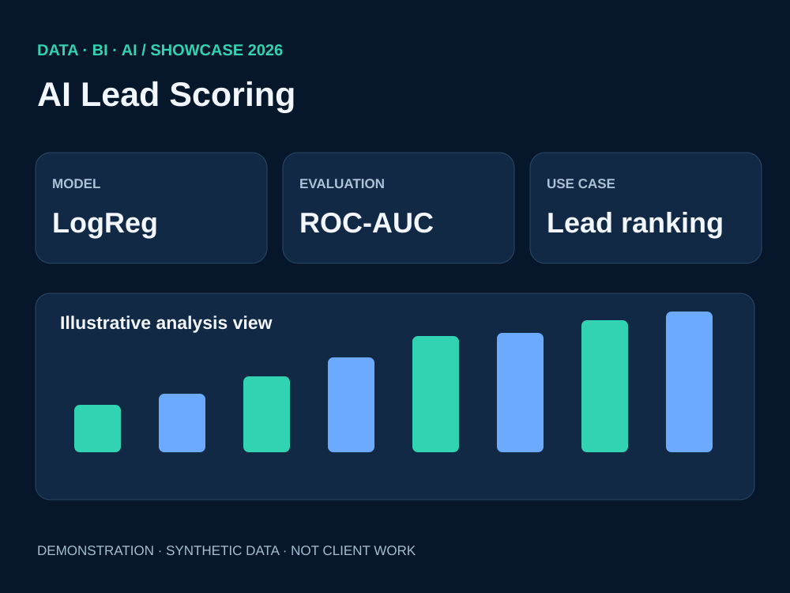

# AI Lead Scoring & Predictive Analytics | Python ML

**Problem:** Rank incoming leads by estimated conversion probability and organize them into actionable score bands.

**Solution design:** Clean variables, encode lead sources, scale numerical variables, fit Logistic Regression in a scikit-learn Pipeline and evaluate on a stratified holdout set.

**Illustrative evaluation:** ROC-AUC = 0.694 on 550 holdout examples; 59.4% conversion in the highest scoring quartile. These are results on a sample dataset, not a claimed marketing uplift.

**Deliverables:** [Executable Python model example](../src/ai_demo.py), [Model metrics](../data/ai_model_metrics.txt), model evaluation visualization.

For deeper project documentation, see the existing [lead conversion ML repository](https://github.com/Othmane-data/lead-conversion-ml-databricks/tree/main).

**Tech keywords:** Machine Learning · Python · Scikit-learn · Predictive Analytics · Classification.
