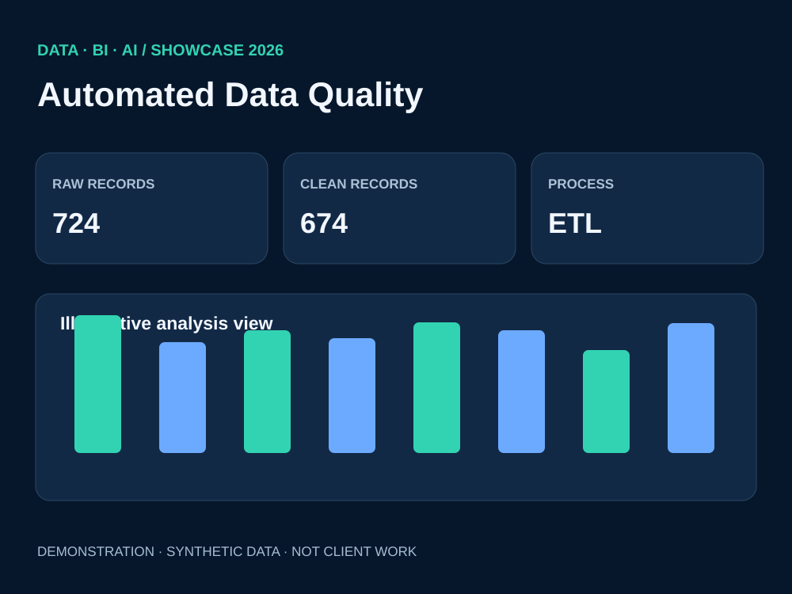

# Data Cleaning & ETL Automation | Python + SQL

**Problem:** Duplicate transaction identifiers, missing and negative amounts, and inconsistent text values can distort recurring reports.

**Solution:** Read source records, standardize text and status fields, deduplicate by transaction ID, exclude invalid amounts, export clean CSV and a SQL database, then run validation queries.

**Data quality results:** 724 sample input records → 674 validated outputs; 24 duplicates, 10 missing amounts and 16 negatives identified.

**Deliverables:** [Python ETL pipeline](../src/etl_demo.py), [SQL quality rules](quality_checks.sql), [quality-check summary](../data/etl_quality_summary.csv).

**Tech keywords:** Python · SQL · ETL · Data Cleaning · Data Validation · Reporting Automation.
