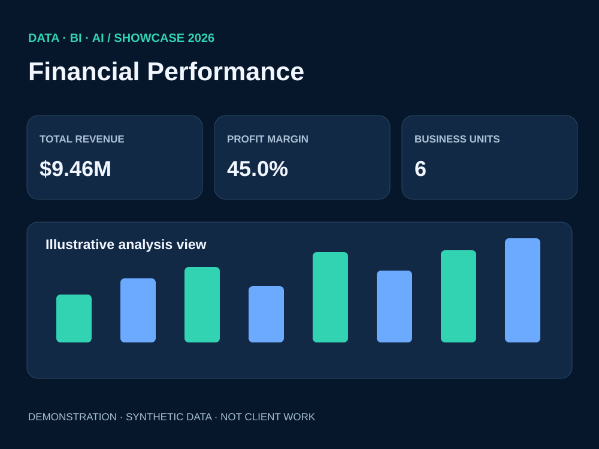

# 01 — Financial Performance Dashboard

**Business question:** How can a management team monitor operating profit, revenue, expense pressure and margin consistently across multiple business units?

**Technical demonstration:** A 12-month *synthetic* dataset for six business units, with revenue, expenses and operating profit. This case illustrates a logical reporting workflow suitable for implementing in Power BI.

**Suggested model:** FactFinance(month, unit, revenue, expenses, profit), DimDate and DimBusinessUnit. Use a dedicated Date table when implementing time-intelligence DAX.

**KPIs:** Total Revenue, Total Expenses, Operating Profit, Profit Margin %, Cost-to-Income %, MoM revenue change. See [DAX examples](measures.dax).

**What the visual communicates:** Management-level KPI cards, monthly revenue/expense comparisons and profit by division.

**Honest scope:** The image is a dashboard concept, not a native Power BI export. The separate [Clothing Store repository](https://github.com/Othmane-data/Clothing-Store_Dashboard_by_POWER_BI) does contain an actual editable Power BI file. No client data or verified ROI has been used here.
