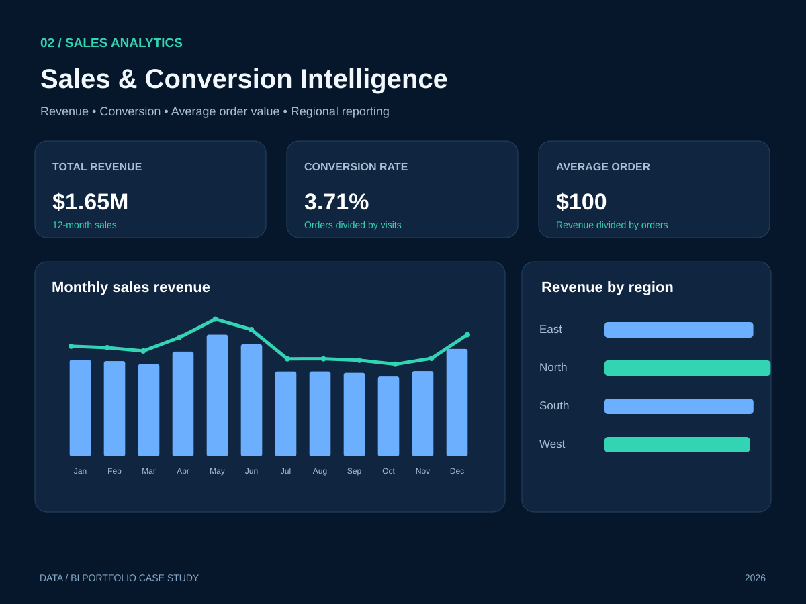

# 02 — Sales & Conversion Intelligence

**Business question:** Which channels and territories drive revenue, conversion and average basket size? Where should sales teams investigate performance?

**Technical demonstration:** Sales reporting with a *synthetic* 12-month dataset aggregating visits, orders and sales by four regions and four channels.

**KPI definitions:** Conversion Rate = Orders / Visits; Average Order Value = Revenue / Orders; Total Sales = SUM(Revenue). Do not average individual subgroup conversion percentages unweighted.

**Suggested model:** FactSales(month, region, channel, visits, orders, revenue) plus dimensions Date, Region and Channel.

**Implementation:** [DAX examples](measures.dax) for Power BI. The dashboard concept highlights trends, regions and KPI definitions; it is not a real PBIX screenshot.

**Further evidence:** A genuine Power BI [project with a .pbix file and screenshots](https://github.com/Othmane-data/Clothing-Store_Dashboard_by_POWER_BI) is also available in this account.
